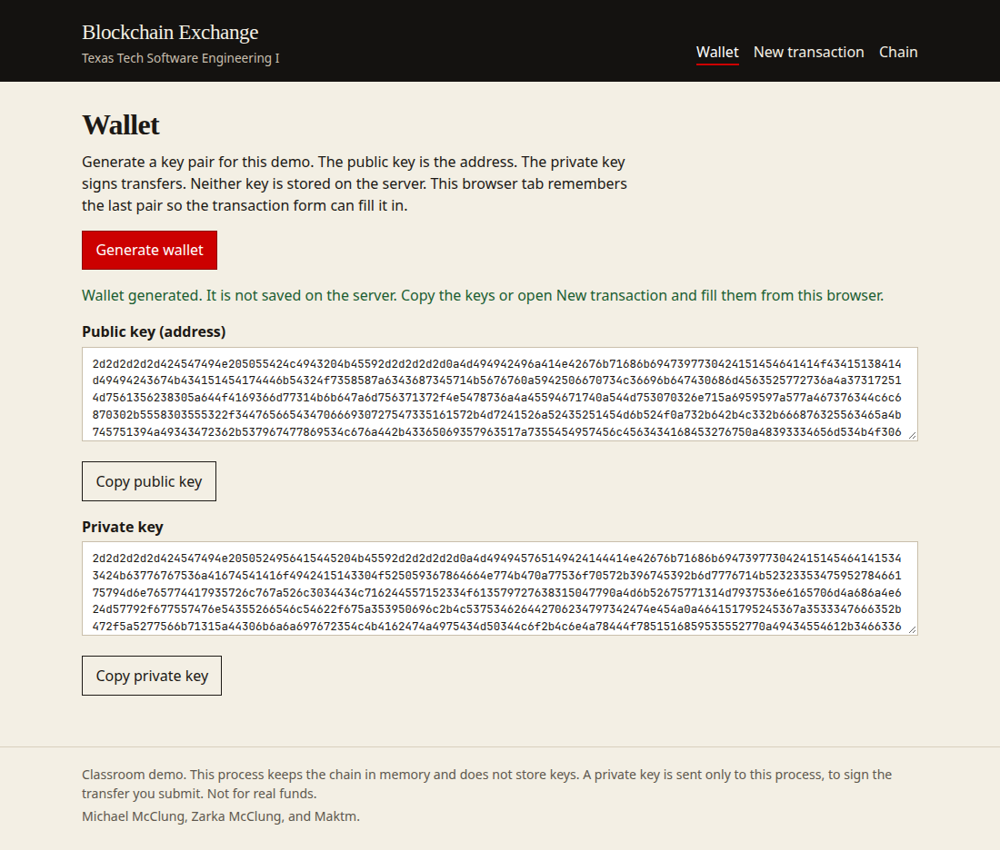
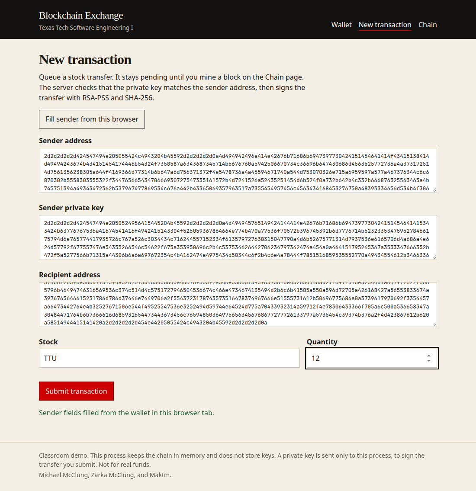
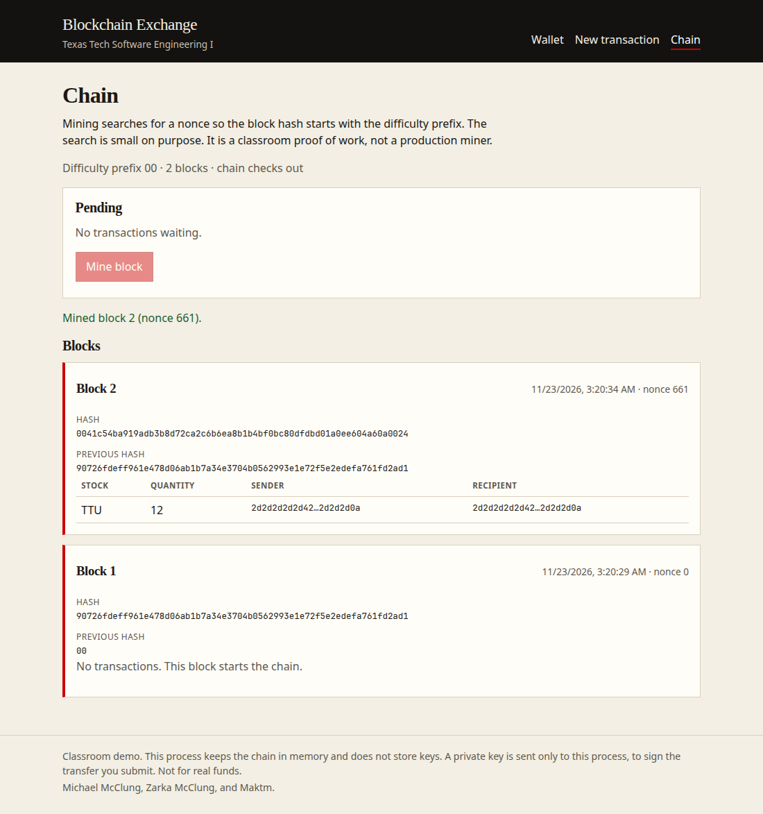

# Blockchain Exchange

A classroom blockchain exchange and a face-controlled virtual mouse, revived from a Texas Tech Software Engineering I team project (about 2019–2020) so it runs on Python 3.11 and newer.

Michael McClung wrote the original Tkinter launcher. Zarka McClung wrote the virtual mouse. Maktm (Michael Kiros) wrote the 2019 Flask exchange. The exchange is included with Michael McClung’s approval, and Maktm’s commits are in this repository’s history. See [CREDITS.md](CREDITS.md).

The exchange records a stock ticker and a quantity on a toy chain. It does not connect to a market and it is not for real funds.

## Live demo

<https://michael-mcclung.github.io/blockchain-exchange/>

That page is a static, in-browser version of the exchange. It generates keys with the Web Crypto API (RSA-PSS, SHA-256), signs transfers in the page, and mines a block whose SHA-256 hash starts with `00`. The chain is stored in that browser’s `localStorage`. It does not share data with the Flask app.

[`.github/workflows/pages.yml`](.github/workflows/pages.yml) publishes the `demo/` folder to GitHub Pages when commits land on `main`.

One-time setup, before the link above serves anything: on GitHub, open **Settings → Pages → Build and deployment** and set **Source** to **GitHub Actions**.

To try the same page on your machine:

```bash
python -m http.server -d demo 8000
```

Open <http://127.0.0.1:8000/>. Opening the HTML file directly does not work: Web Crypto is unavailable on `file://` pages.

The virtual mouse is desktop-only. The demo’s About section describes what it does.

## Screenshots

Flask app, running locally.







## What you can do

**Exchange**

- Generate a 2048-bit RSA wallet. The public key is the address. The server does not store the keys.
- Submit a ticker and a whole-number quantity. The transfer is checked, signed, and left pending.
- Mine a block. The nonce is the first value whose block hash starts with the difficulty prefix (`00` unless `POW_PREFIX` is set).
- Read the chain: block hashes, the previous-hash link, and whether the signatures still check out.

Stopping the process clears the chain. Nothing is written to disk.

**Virtual mouse** (webcam and a desktop session)

- Hold the mouth open to toggle pointer control. The nose is compared with an anchor point to move the cursor.
- Hold one eye closed to click. The camera image is mirrored, and the program swaps the eye landmarks so the wink matches that view.
- Hold both eyes closed to toggle scroll mode. Esc quits.
- If the landmark file or the webcam is missing, the program prints what to do and exits. It does not traceback on those two cases.

## Tech stack

- Python 3.11+, Flask, `cryptography`
- pytest and GitHub Actions
- Browser demo: HTML, CSS, and the Web Crypto API, with no build step
- Virtual mouse, optional: OpenCV, dlib, imutils, PyAutoGUI, NumPy
- Optional Flask host: Gunicorn, configured by `render.yaml`

## Run the exchange locally

```bash
python3 -m venv .venv
source .venv/bin/activate
pip install -r requirements.txt
python -m exchange
```

Open <http://127.0.0.1:5000/>.

`python launcher.py exchange` does the same and opens a browser. `python launcher.py` opens a small window with the original two choices, Block Chain and Virtual Mouse, when Tk and a display are available. Debian/Ubuntu: `python3-tk`. On macOS, use a Python that includes Tcl/Tk. Without that window:

```bash
python launcher.py exchange
python launcher.py mouse
```

| Variable | Default | Role |
| --- | --- | --- |
| `EXCHANGE_HOST` | `127.0.0.1` | Address the Flask process binds to |
| `EXCHANGE_PORT` | `5000` | Port, unless `PORT` is set |
| `PORT` | unset | Overrides the port (Render sets this) |
| `EXCHANGE_DEBUG` | unset | Turns on the Flask debugger. The reloader stays off so there is only one chain |
| `POW_PREFIX` | `00` | 1–3 hex characters the mined block hash must start with. Anything else falls back to `00` |
| `FACE_MODEL_PATH` | `virtual_mouse/model/shape_predictor_68_face_landmarks.dat` | Landmark file |
| `FACE_CAMERA_INDEX` | `0` | Webcam device index |

There is no checked-in secret. The Flask app does not use a secret key.

The transaction form sends the private key to this process so the process can sign, which is how the 2019 app worked. The process does not store or log the key. Use it only on a machine you control.

## Run the virtual mouse

```bash
pip install -r requirements-mouse.txt
python -m virtual_mouse.download_model
python launcher.py mouse
```

The model is dlib’s 68-point predictor, about 64 MB compressed, from <https://dlib.net/files/shape_predictor_68_face_landmarks.dat.bz2>. This repository does not include the file. Review the dlib project’s license before you download it. Steps are also in [virtual_mouse/model/README.md](virtual_mouse/model/README.md).

`dlib` may need CMake and a C++ compiler when pip has no wheel for your platform. The exchange does not need it.

macOS will ask for camera permission. The window needs a desktop session. Throw the pointer into a screen corner to abort (PyAutoGUI’s fail-safe).

## Tests

```bash
pip install -r requirements-dev.txt
pytest
```

The tests cover signing, rejected transactions, mining, the hash link, the three HTML pages, the launcher’s command parsing, and the virtual mouse’s geometry helpers. They also check that a missing landmark file exits with a message instead of a traceback.

[`.github/workflows/ci.yml`](.github/workflows/ci.yml) runs pytest on Python 3.11 and 3.12 and checks that `demo/exchange.js` parses. CI does not start a webcam or install dlib.

## Optional Flask host

GitHub Pages is the demo that runs without a new account. `render.yaml` is there if you want the Flask process itself on Render’s free web service:

1. Create a free Render account and a new Blueprint pointed at this repo.
2. If the blueprint rejects `plan: free`, choose the free instance type in the dashboard. Free-tier names change.
3. Leave the start command as a single Gunicorn worker. Each worker would have its own chain.
4. The free service sleeps, and the in-memory chain is wiped when the process stops.

Do not type a real private key into a server you do not control.

## What changed from the 2019 code

The behavior above is what the revived app actually does. Compared with [Maktm/blockchain-exchange](https://github.com/Maktm/blockchain-exchange):

- Dependencies are current. The old `requirements.txt` pinned Flask 1.0.2 and does not install on Python 3.11.
- Signatures use RSA-PSS with the SHA-256 digest length as the salt. The old `PSS.MAX_LENGTH` pair does not reliably verify on current `cryptography`.
- The signed bytes are canonical JSON, not `str(OrderedDict(...))`.
- A missing field, a bad quantity, or a private key that does not match the sender returns HTTP 400. The old handler printed the form (including the private key) and still returned 200 when verification failed.
- Mining is its own request. The old nonce was `randrange(0, 1000)` and did not depend on the block contents.
- The chain page reads the `chain` list. The old page looped on `response.length`, which is undefined on that JSON object, and it assumed every block, including genesis, had a transaction.
- The process binds to `127.0.0.1` unless `EXCHANGE_HOST` is set. Debug is off unless `EXCHANGE_DEBUG` is set.

## Layout

```
exchange/          Flask app. History includes Maktm's commits (git subtree)
virtual_mouse/     Face-controlled mouse
launcher.py        Window or CLI for either program
demo/              In-browser exchange published to GitHub Pages
tests/             pytest
render.yaml        Optional free-tier Flask host
CREDITS.md         Authors and the original repositories
```

## Limitations

- Classroom project. No market data, no accounts, no persistence.
- The proof of work is deliberately small.
- The Flask form sends the private key to the local process. The browser demo signs locally and does not.
- The Flask chain and the browser-demo chain are separate. This repository does not import one into the other.
- The virtual mouse is not part of the web demo.
